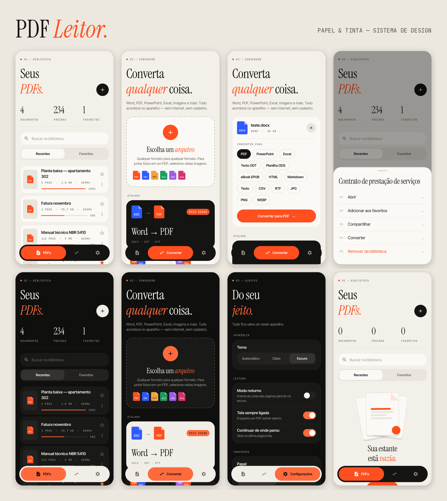

# PDF Leitor (Android)

Aplicativo Android nativo para **ler PDFs** e **converter documentos**, funcionando
**100% offline**: não pede internet, login nem cadastro. O app não declara nenhuma
permissão (nem `INTERNET`), então os arquivos nunca saem do aparelho.

**APK pronto para instalar:** [`release/PDFLeitor.apk`](release/PDFLeitor.apk)
(Android 5.0 ou superior, ~200 KB).



## Design — "Papel & Tinta"

Estética editorial e tátil, feita à mão sem bibliotecas de UI:

- **Tipografia:** Instrument Serif (títulos grandes, com palavras em itálico no tom de destaque),
  Inter Tight (interface) e JetBrains Mono (rótulos em caixa alta no estilo índice: `01 — BIBLIOTECA`).
  Fontes OFL embutidas em `assets/fonts`.
- **Cor:** fundo cor de papel `#F3F0E9`, tinta `#141412` e um único acento vermelhão `#FF4F1F`;
  tema escuro com tinta profunda e a barra inferior invertida em creme. Etiquetas de formato coloridas
  em forma de arquivo com canto dobrado.
- **Componentes próprios:** barra inferior flutuante em cápsula com pílula que desliza e se expande,
  controles segmentados com indicador animado, interruptores desenhados à mão, painéis que sobem de
  baixo (no lugar dos diálogos padrão), avisos em cápsula, carregador em linha, selo de sucesso animado
  e ilustração de folhas flutuantes no estado vazio.
- **Movimento:** curva `cubic-bezier(0.2, 0, 0, 1)` em todo o app; entradas escalonadas, transição
  lateral entre abas, contadores animados e leve encolhimento ao toque.

## Telas (barra inferior)

| Aba | O que faz |
|-----|-----------|
| **PDFs** | Lista todos os PDFs já abertos, com miniatura, nº de páginas, tamanho e a página em que você parou. Busca por nome, favoritos (estrela), compartilhar, converter e remover da lista. Botão **Abrir PDF** (seleção de um ou vários). |
| **Converter** | Conversão livre (qualquer formato → qualquer formato) e 16 atalhos: Word→PDF, PDF→Word, PowerPoint→PDF, PDF→PowerPoint, Excel→PDF, PDF→Excel, Imagens→PDF, PDF→JPG, PowerPoint→Word, Excel→Word, Word→PowerPoint, Word→Excel, PowerPoint→Imagens, PDF→Texto, HTML/Markdown→PDF, EPUB→PDF. Lista dos arquivos convertidos (abrir, enviar, salvar em…, excluir). |
| **Configurações** | Tema (automático/claro/escuro), modo noturno de leitura, manter tela ligada, continuar de onde parou, tamanho do papel (A4/Carta), margens, qualidade das imagens (DPI), imagem das páginas em PDF→Word, salvar cópia em Downloads, limpeza de histórico/cache. |

### Leitor de PDF
- Rolagem contínua, zoom por pinça e toque duplo, renderização nítida da área visível ao dar zoom.
- Barra de páginas (arrastar para navegar), "ir para página", **busca de texto** no documento.
- Modo noturno, informações do arquivo, compartilhar, abrir em outro app, "Converter este PDF".
- Registra-se como leitor de PDF do sistema ("Abrir com → PDF Leitor").
- PDFs recebidos de outros apps são copiados para a biblioteca interna para poderem ser reabertos depois.

### Formatos

| Lê | Gera |
|----|------|
| PDF, DOCX, PPTX, XLSX, ODT, ODS, ODP, EPUB, HTML, Markdown, TXT, CSV, RTF, JPG, PNG, WEBP, GIF, BMP | PDF, DOCX, PPTX, XLSX, ODT, ODS, EPUB, HTML, Markdown, TXT, CSV, RTF, JPG, PNG, WEBP |

Limitações conhecidas:
- Formatos binários antigos do Office 97-2003 (`.doc`, `.xls`, `.ppt`) não são suportados (o app avisa e sugere salvar como `.docx/.xlsx/.pptx`).
- PDF → Word/Excel/Texto extrai o texto do PDF; PDFs digitalizados (só imagem) não têm texto — nesse caso a imagem da página é incluída no Word (não há OCR offline).
- PDFs protegidos por senha não abrem.
- A fidelidade visual das conversões é boa para documentos comuns (títulos, parágrafos, listas, tabelas, imagens, slides); layouts muito elaborados podem perder detalhes.

## Como compilar

### Opção 1 — script (sem Gradle)
Requer JDK 17+ e as ferramentas do Android SDK (`aapt2`, `dx`/`d8`, `zipalign`, `apksigner`).
No Ubuntu/Debian:

```bash
sudo apt-get install android-sdk-platform-23 android-sdk-build-tools apksigner zipalign dalvik-exchange
./build-apk.sh          # gera release/PDFLeitor.apk
```

Variáveis opcionais: `ANDROID_JAR`, `BUILD_TOOLS`, `KEYSTORE`, `KS_PASS`.

### Opção 2 — Android Studio / Gradle
Abra a pasta `pdf-android` no Android Studio (ou rode `./gradlew assembleRelease`).
O projeto não tem dependências externas além do Android Gradle Plugin.

### Assinatura
`keystore/debug.keystore` (senha `android`, alias `pdfleitor`) é uma chave de
desenvolvimento usada pelos dois métodos, para que atualizações instalem por cima.
Para publicar na Play Store, gere uma chave própria e **não** a versione.

## Arquitetura

```
app/src/main/java/br/pdfleitor/
├── core/   Conversão pura em Java (sem Android) — testável na JVM
│   ├── Doc.java            modelo intermediário (títulos, parágrafos, listas, tabelas, imagens, slides)
│   ├── *Reader.java        DOCX, PPTX, XLSX, ODF, HTML/MD/TXT/CSV/RTF/EPUB
│   ├── PdfText.java        extrator de texto de PDF próprio (xref/object streams, filtros, fontes, ToUnicode)
│   ├── *Writer.java        DOCX, PPTX, XLSX, ODT/ODS, HTML/MD/TXT/CSV/RTF/EPUB
│   └── Engine.java         leitura/escrita por formato
└── app/    Interface e partes gráficas (Android)
    ├── MainActivity        barra inferior: PDFs | Converter | Configurações
    ├── PdfListPage / ConvertPage / SettingsPage
    ├── ViewerActivity + PdfView + PdfDoc   leitor (PdfRenderer nativo)
    ├── PdfDocWriter + SlidePainter         geração de PDF (android.graphics.pdf)
    ├── Converter           orquestra as conversões (PDF↔imagens, documentos)
    └── FilesProvider       compartilhamento seguro de arquivos internos
```

Todas as conversões passam pelo modelo `Doc`: cada leitor produz um `Doc` e cada
escritor consome um `Doc`, o que permite converter de qualquer formato para qualquer outro.
